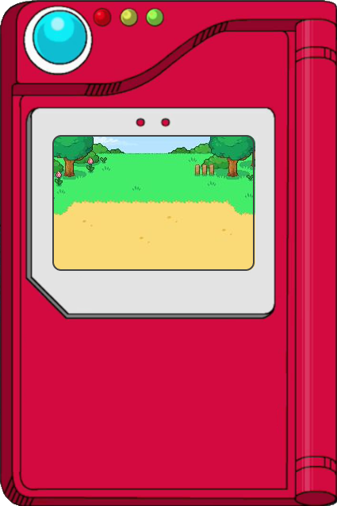

<h1 align="center">
  
  Pokédex
</h1>

<p align="center">
  Uma Pokédex feita com <strong>HTML</strong>, <strong>CSS</strong> e <strong>JavaScript</strong>, que mostra os Pokémon com sprites animados consumindo a <a href="https://pokeapi.co/">PokéAPI</a>.
</p>

<p align="center">
  
  
  
  
  
</p>

---

## 📸 Visual

<p align="center">
  
</p>

A interface fica em cima da imagem de uma Pokédex. Na tela aparecem:

- o **sprite animado** do Pokémon (estilo Pokémon Black & White);
- o **número** e o **nome** do Pokémon;
- um **campo de busca** para digitar o nome ou o número;
- os botões **Prev &lt;** e **Next &gt;** para ir para o Pokémon anterior ou o próximo.

## ✨ Funcionalidades

| Funcionalidade | Status |
| --- | --- |
| Layout da Pokédex com moldura, tela e botões | ✅ Pronto |
| Sprite animado, número e nome do Pokémon | ✅ Pronto (exemplo fixo: #6 Charizard) |
| Busca por nome ou número | 🚧 Em desenvolvimento |
| Navegação com Prev / Next | 🚧 Em desenvolvimento |
| Busca dos dados na PokéAPI | 🚧 Em desenvolvimento (`fetchPokemon` em [js/js/script.js](js/js/script.js)) |

## 🛠️ Tecnologias

- **HTML5**: estrutura da página
- **CSS3**: layout com `position: absolute` em cima da imagem, gradiente no fundo e tamanhos de fonte responsivos com `clamp()`
- **JavaScript**: consumo da API com `fetch`
- **[PokéAPI](https://pokeapi.co/)**: dados e sprites dos Pokémon
- **[Google Fonts: Oxanium](https://fonts.google.com/specimen/Oxanium)**: fonte com visual retrô

## 📁 Estrutura do projeto

```
pokedex/
└── js/
    ├── index.html          # Página principal
    ├── css/
    │   └── style.css       # Estilos da Pokédex
    ├── js/
    │   └── script.js       # Lógica (busca na PokéAPI)
    └── images/
        ├── pokedex.png     # Moldura da Pokédex
        └── favicon-16x16.png
```

## 🚀 Como executar

1. Clone ou baixe este repositório.
2. Abra o arquivo `js/index.html` no navegador.

Não precisa instalar nada. Se preferir, use a extensão **Live Server** do VS Code para recarregar a página sozinha a cada alteração.

## 🔌 Como a PokéAPI é usada

Os dados de cada Pokémon vêm deste endpoint:

```
https://pokeapi.co/api/v2/pokemon/{nome-ou-numero}
```

O sprite animado fica neste caminho da resposta:

```js
data.sprites.versions['generation-v']['black-white'].animated.front_default
```

Exemplo de como a função `fetchPokemon` pode ficar:

```js
const fetchPokemon = async (pokemon) => {
  const APIResponse = await fetch(`https://pokeapi.co/api/v2/pokemon/${pokemon}`);

  if (APIResponse.status === 200) {
    const data = await APIResponse.json();
    return data;
  }
};
```

## 📜 Créditos

- Dados e sprites: [PokéAPI](https://pokeapi.co/)
- Pokémon e Pokédex são marcas registradas da Nintendo, Game Freak e The Pokémon Company. Este projeto foi feito só para estudo.
